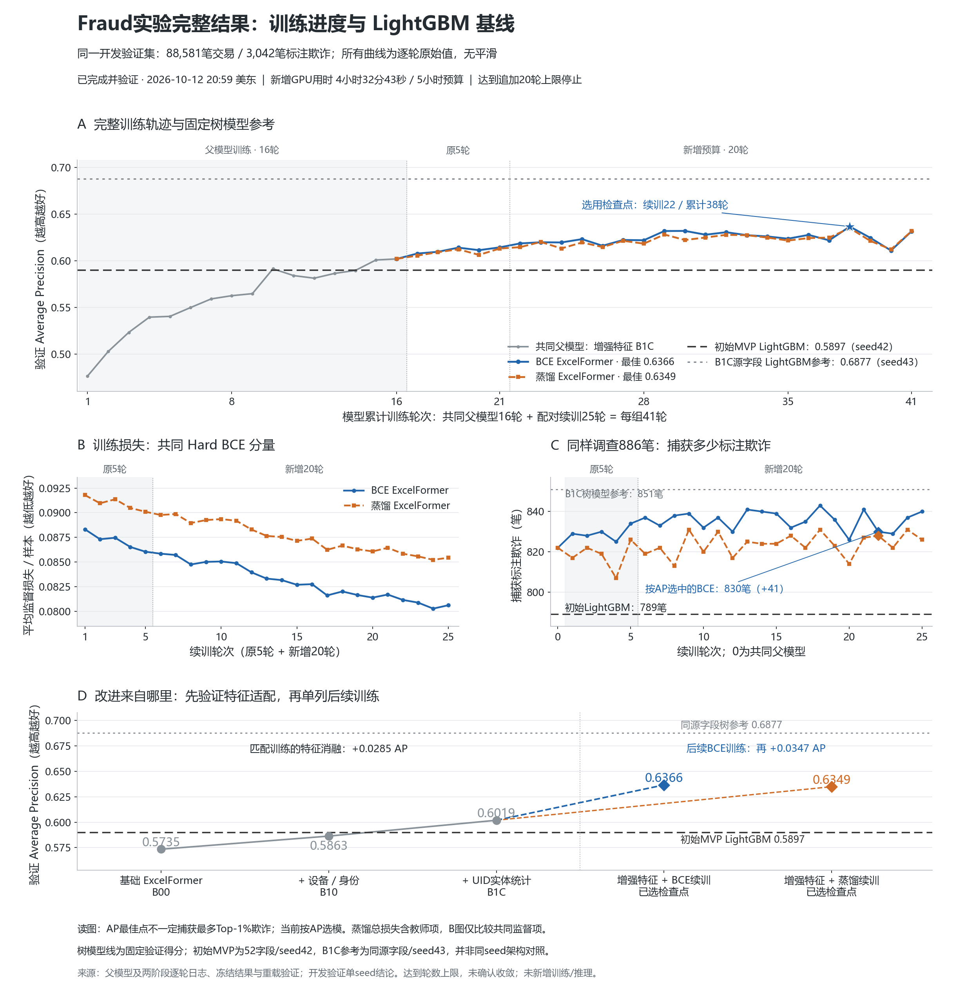

# Fraud Detection and Transaction Risk Ranking

An IEEE-CIS portfolio project on improving the information available to a fraud
ranking model, from an original LightGBM benchmark to feature-enriched ExcelFormer.

## Project story

- Investigated ExcelFormer's initial shortfall against LightGBM by combining transaction, device and identity signals with entity-level patterns in activity frequency and spending variability.
- Adapted ExcelFormer's inputs to preserve missing-value signals and encode categories using earlier training records, enabling interactions across the enriched risk features. Matched feature ablations raised average precision (AP) from **0.5735 to 0.6019**.
- Extended BCE training with feature mixing and validation-based checkpoint selection, reaching **0.6366 AP versus 0.5897** for initial LightGBM on the same development-validation set; identified **41 more labeled fraud cases** within a fixed **886-transaction review budget**.

## Complete results



[Vector figure](reports/training_complete_20261012/training_complete.svg) ·
[Figure data and reproduction](reports/training_complete_20261012/README.md)

The figure covers the shared parent and both complete training continuations,
loss, review-budget capture, and feature ablations. Metrics are raw epoch values.
The selected BCE checkpoint captures **830 vs. 789** labeled frauds. It was
selected by validation AP, not by the maximum capture count across epochs.

## What is included

- `src/`, `configs/`, `tests/`: the original fixed LightGBM/FT-Transformer MVP.
- `experiments/`: feature construction, identity/UID grouping, typed input
  adaptation, ExcelFormer BCE training, paired continuation and verification code.
- `evidence/results_summary.json`: the checked comparison and scope.
- `evidence/final_training/`: final training metrics, stopping reason, checkpoint
  replay checks and learning curves.
- `evidence/feature_ablation/` and `evidence/training_histories/`: complete epoch logs.
- `evidence/initial_continuation/`: the initial paired five-epoch results and checks.
- `evidence/original_mvp/`: the original FT/LightGBM curves and separate held-out evaluation.
- `reports/training_complete_20261012/`: PNG/SVG, plot data and standalone renderer.
- `UPSTREAM_SOURCES.json`: pinned external model/reference provenance.

This branch contains the fraud MVP snapshot. It does not modify `main`.
Raw datasets, derived row-level tensors, predictions, checkpoints, environments,
credentials, unrelated research and personal application documents are excluded.
Local absolute paths and artifact/data/checkpoint fingerprints remain in the
private audit records; published metrics, curves and model source are retained.

## Reproduction and dependencies

Use the labeled IEEE-CIS training files obtained under the competition's terms:
[official data page](https://www.kaggle.com/competitions/ieee-fraud-detection/data).
CUDA PyTorch 2.5.1 is required for neural training. The original baseline entry:

```powershell
python -m pip install -r requirements.txt
python -m src.run --stage all --data data/raw/train_transaction.csv
```

The follow-up scripts are preserved historical source snapshots. They require
the original local feature caches, pinned ExcelFormer code and full optimizer/RNG
checkpoints; these are not downloadable models in this branch. Read
[SOURCE_MAP.md](SOURCE_MAP.md) before running an archived campaign. Frozen hashes
remain enforced: missing artifacts or changed sources must not be bypassed.
This publication did not rerun training or access evaluation labels.

## Evidence boundaries

The headline is a development-validation **pipeline** improvement over the original
MVP. It is not a claim of production savings or independent future generalization.
The matched enriched LightGBM reference (AP 0.6877) remains stronger. Paired
distillation (AP 0.6349) did not improve on BCE (AP 0.6366).
Early stopping was configured; the extension stopped at its epoch cap.
ExcelFormer is an existing architecture; contributions here are feature
organization, input adaptation, training integration and controlled evaluation.
