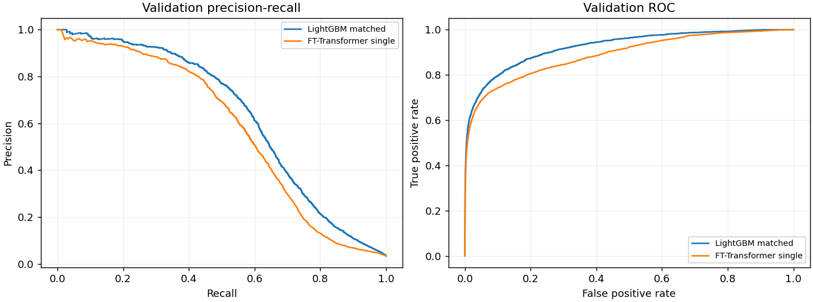
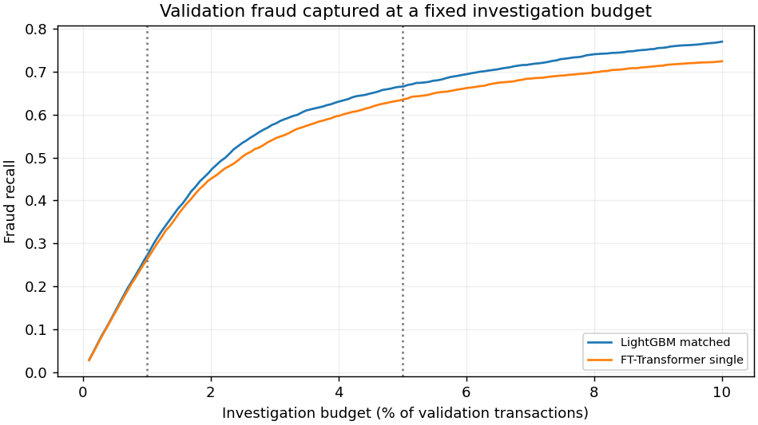
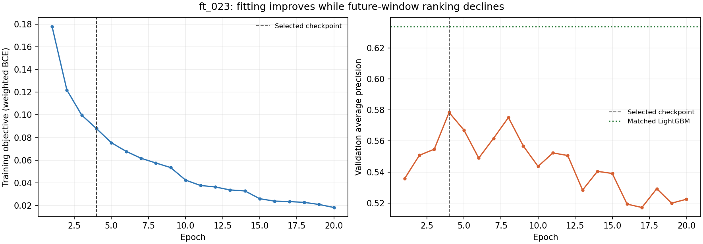

# 欺诈检测实验：当前进度与拟合诊断

快照：**2026-10-10T08:10:44-04:00，America/New_York**。这是静态进度快照，后续本地训练不会自动更新此页面。

**当前结论：最佳单 FT-Transformer 尚未超过匹配 LightGBM；最佳试验存在明显训练后期过拟合迹象，欠拟合及性能差距的完整原因仍未测清。** 本轮最终评价尚未执行。

## 从交易记录到调查队列

使用 IEEE-CIS 的 `train_transaction.csv`，按 `TransactionDT` 排序后做 70% / 15% / 15% 划分。训练 413,378 行，验证 88,581 行。`TransactionID` 只用于对齐和分数并列时的固定排序。

所有中位数、标准化/分位数转换、类别词表、频率、缺失指示和数值编码边界只在训练数据上拟合。FT 将数值转换为 feature tokens、将类别转换为 embeddings，再通过特征间 attention 输出风险分数。这里 attention 主要连接同一交易的不同字段，并不是跨交易的时序 Transformer。LightGBM 使用匹配字段及训练记录拟合树。

按风险分数排序，调查最高分的固定比例，计算欺诈捕获率和调查命中率；不按最终测试标签调阈值。

## 实际验证结果

| 模型 | ROC-AUC | PR-AUC / AP | Recall@1% | Precision@1% | Recall@5% | Brier |
|---|---:|---:|---:|---:|---:|---:|
| 最佳单 FT `ft_023` | 0.8898 | 0.5784 | 26.10% | 89.62% | 63.48% | 0.02510 |
| 匹配 LightGBM `lgb_rich_all_stronger` | 0.9255 | **0.6339** | **27.05%** | **92.89%** | **66.50%** | **0.01914** |

验证集有 3,042 笔欺诈。调查 886 笔交易时，FT 捕获 794 笔，LightGBM 捕获 823 笔。两者使用相同有序 ID 与标签，保存预测的指标已自行复算通过；这不等同于独立模型复现。所有数字均为**验证集**，没有混用原 MVP 的测试结果。

## 欠拟合还是过拟合

最佳试验 `ft_023` 的第 4 轮：训练 objective=0.0878，验证 AP=0.5784；第 20 轮：训练 objective=0.0182，验证 AP=0.5224。训练目标继续改善而验证排序持续回落，支持后期过拟合的判断。`ft_015` 也有类似趋势。

当前报告取最佳 checkpoint，而非末轮。因此后期过拟合不能直接解释最佳 checkpoint 对 LightGBM 的全部差距。日志尚无固定样本、`eval()` 模式下的训练 AP、验证 objective 与最佳/末轮训练 AP 差距。训练时的 class weighting、recency sampling 和 dropout 会影响 loss；不能用低 loss 排除对稀少欺诈模式的欠拟合，也不能跨不同 loss 直接比较绝对值。

## 已观察到的分布变化与尚未验证的原因

- `M1` 缺失率从训练 53.80% 到验证 26.78%；`M7` 从 66.92% 到 39.97%。
- `card1_card2_addr1` 的未知/稀有映射比例从训练 3.63% 到验证 6.89%。未知编码同时包含词表外类别和训练中被过滤的稀有类别，不能全部称为新实体。
- 类别稀疏性、无关/冗余特征、时间漂移、数值编码、attention 压缩、优化设置和 BCE 与 AP 的目标差异都是待检验假设，尚未建立因果归因。
- 当前优胜配置同时改变了若干设置，不能把提升单独归功于某一结构、loss 或特征。多个随机种子与受控消融仍有价值。

FT 的原论文也没有声称它普遍胜过 GBDT：[NeurIPS 2021](https://proceedings.neurips.cc/paper/2021/hash/9d86d83f925f2149e9edb0ac3b49229c-Abstract.html)。表格数据的归纳偏置问题见 [NeurIPS 2022](https://proceedings.neurips.cc/paper_files/paper/2022/hash/0378c7692da36807bdec87ab043cdadc-Abstract-Datasets_and_Benchmarks.html)，时间漂移问题见 [ICML 2025](https://proceedings.mlr.press/v267/cai25j.html)。这些文献支持诊断方向，不证明本数据上的原因，也不保证 Transformer 胜出。

## 预算、执行与失败

- 有效完成神经试验 **25** 个，失败记录 **1** 个；当前 `ft_026`，已保存轮数 10。
- 实际神经训练/验证及检查点保存累计 **7.05 小时**；campaign 经过 **7.33 小时**。等待、CPU 树训练和资料整理不计入神经训练。12 小时下限尚未达到，24 小时预算及原开始时间不重置。
- 最佳 FT 单试验耗时 **25.32 分钟**，峰值 CUDA allocated **2078.5 MiB**；匹配 LightGBM 耗时 **172.4 秒**，CPU 8 线程。单试验耗时不等于整个搜索成本。
- RTX 4080 SUPER，Python 3.12.7，PyTorch 2.5.1+cu121，CUDA 12.1，BF16。未采用 Transformer CPU fallback。
- `ft_013` 因 CUDA multinomial 的 deterministic 实现限制失败。修复仅让抽样索引在 CPU 产生，模型仍在 CUDA；失败保留，`ft_016` 新试验重试成功。没有覆盖有效结果、迁移不兼容 checkpoint 或重置预算。
- 原 MVP 的 64 个受保护文件 SHA256 校验通过。公开包不包含这些文件中的私有数据、预测及权重，因此不是完整的本地冻结资产备份。

## 证据与复现入口

- [本轮状态](experiments/ft_upgrade_20261010/progress/20261010T121044Z/status.json)，[完整验证指标](experiments/ft_upgrade_20261010/progress/20261010T121044Z/validation_metrics.csv)。
- [全部已完成神经试验](experiments/ft_upgrade_20261010/progress/20261010T121044Z/neural_trials.csv)，[训练曲线原始记录](experiments/ft_upgrade_20261010/progress/20261010T121044Z/training_history.csv)。
- [当前最佳配置](experiments/ft_upgrade_20261010/progress/20261010T121044Z/selected_configs.json)，[特征名单与输入指纹](experiments/ft_upgrade_20261010/progress/20261010T121044Z/feature_manifests.json)。
- [训练/验证分布](experiments/ft_upgrade_20261010/progress/20261010T121044Z/train_validation_distributions.json)，[失败保留与恢复说明](experiments/ft_upgrade_20261010/progress/20261010T121044Z/failures.json)。
- [固定协议](experiments/ft_upgrade_20261010/protocol.json)，[执行源代码](experiments/ft_upgrade_20261010/train.py)。
- [原 MVP 历史测试汇总](results/original_mvp/metrics.csv)：属于已看过的旧测试，不是本轮新的独立测试。

原始数据必须自行通过 [Kaggle](https://www.kaggle.com/competitions/ieee-fraud-detection/data) 的访问流程获得。公开 GitHub 包不含数据、逐行预测、模型或凭据。原 MVP 可从 `src.run` 复现；长 campaign 还依赖本地准备缓存和原 MVP artifact manifest。执行命令与依赖见 [README](README.md)。阅读公开快照不需要启动训练。

**最有价值的下一步：在安全的串行 GPU 边界，测量固定训练/验证样本上同口径的 AP 与 loss，并比较最佳和末轮 checkpoint，再决定一项受控消融。** 独立只读 review 尚未执行；新 thread 的选择仍等待用户回复。最终测试只允许在验证选择锁定后探索性评价一次，不能重新称为未接触的独立证据。没有生产就绪或降低金融损失的结论。
